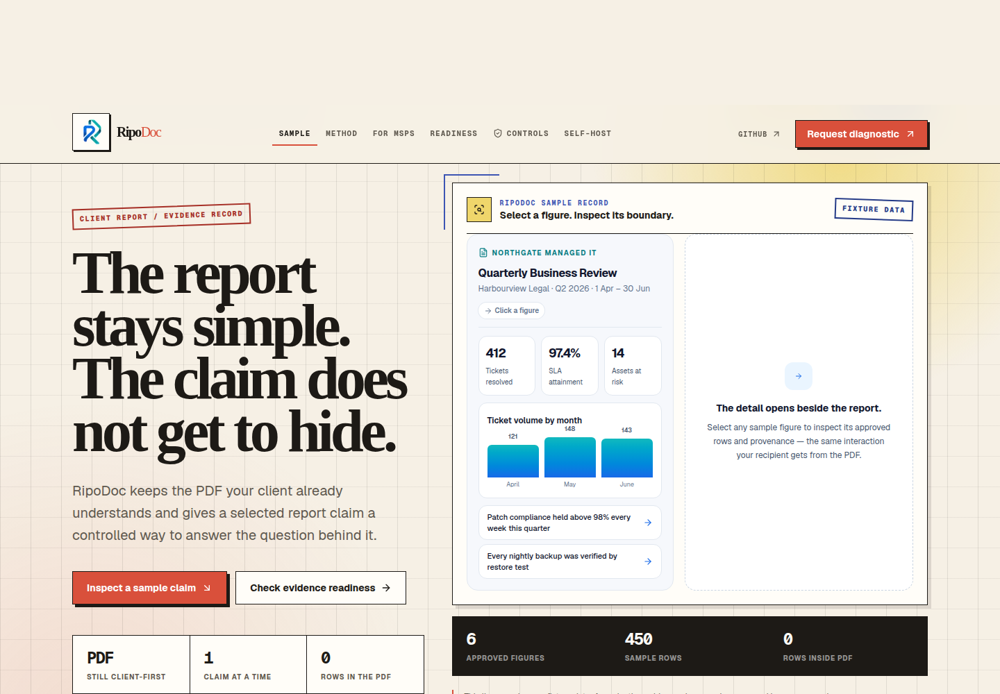

<p align="center">
  <a href="https://www.ripodoc.com"></a>
</p>

# RipoDoc

> **Controlled evidence delivery for MSP client reports.**
>
> Keep the PDF your client already trusts. Let a selected reported figure open the **approved evidence** behind it—scoped to the intended reader, limited in time, revocable, and audit-aware.

[](https://nodejs.org/)
[](https://nextjs.org/)
[](https://www.typescriptlang.org/)
[](https://www.ripodoc.com/download)

**Website:** [ripodoc.com](https://www.ripodoc.com) · **For MSPs:** [demo & fit](https://www.ripodoc.com/for-msps) · **Claim sample:** [inspect the interactive report evidence](https://www.ripodoc.com/#sample-report) · **Method:** [how it works](https://www.ripodoc.com/how-it-works) · **Evidence readiness:** [five-check decision aid](https://www.ripodoc.com/report-evidence-readiness) · **Security boundary:** [security controls](https://www.ripodoc.com/security) · **Self-hosting:** [download & deployment](https://www.ripodoc.com/download)

---

## See the real product surface

<p align="center">
  <a href="https://www.ripodoc.com/#sample-report"></a>
</p>

The image above is captured from the local RipoDoc application and uses the shipped **sample data**—not client information. Explore the live [interactive claim sample](https://www.ripodoc.com/#sample-report), read the [MSP demo and fit guide](https://www.ripodoc.com/for-msps), or download the short capture-based [demo tour video](docs/assets/ripodoc-demo-tour.mp4). The animated [GIF version](docs/assets/ripodoc-demo-tour.gif) is available for platforms that do not play MP4 previews.

> The demo tour is a visual walkthrough of actual local pages. It does not simulate customer use, make performance claims, or depict a configured hosted workspace.

## The report is the interface. The evidence should be accountable.

Managed Service Providers routinely deliver QBRs, monthly service reports, security reports, and executive updates as PDFs. When a client asks, “Where did that number come from?”, the answer is often a sprawling spreadsheet, an over-broad portal, or a follow-up meeting.

RipoDoc adds a **deliberate proof path** to that moment. It preserves a familiar client artifact while keeping the evidence behind an approved claim close, controlled, and inspectable.

| RipoDoc is | RipoDoc is not |
| --- | --- |
| An evidence-delivery layer for a selected client-report claim | A replacement for PSA, RMM, BI, or client-portal platforms |
| A workflow that starts with reviewed structured data and provenance | A promise to extract defensible evidence from any arbitrary PDF chart |
| A path for recipient-aware, expiring, revocable evidence access | A permanent public share link |
| A self-hostable application and private authoring-worker design | A claim that the hosted evaluation surface is production-enabled by default |

> **Hosted-workspace status:** the public deployment intentionally fails closed for account actions until durable identity, email, CAPTCHA, audit storage, and private-worker configuration pass the relevant release gate. The public site is an evaluation and documentation surface—not an invitation to submit client data.

## See the method in one minute

```text
Reviewed source data
        │
        ▼
Approve a figure + its supporting rows, provenance, recipient and expiry
        │
        ▼
Publish a validated report manifest
        │
        ▼
Deliver the familiar PDF
        │
        ▼
Reader opens a controlled proof view for that specific report claim
```

The evidence view is designed to return **only the approved rows for the requested figure** after evaluating its access condition. Evidence access events can be added to a tamper-evident hash chain for later verification.

Explore the public [interactive claim sample](https://www.ripodoc.com/#sample-report), use the no-data [evidence-readiness check](https://www.ripodoc.com/report-evidence-readiness), or read the full [RipoDoc method](https://www.ripodoc.com/how-it-works).

## Start locally

RipoDoc requires **Node.js 22.6 or newer** because its toolchain uses native TypeScript stripping.

```bash
git clone https://github.com/thecelestialmismatch/RipoDoc.git
cd RipoDoc

npm install
npm install --prefix web/frontend

# A server-only signing secret is required for evidence delivery.
export RIPODOC_EVIDENCE_SECRET="$(openssl rand -base64 32)"

# Start the public application.
npm --prefix web/frontend run dev
```

In another terminal, produce a local clickable fixture report:

```bash
npm run build:pdf:local
```

Open `build/demo-report.local.pdf`, select a marked report figure, and inspect the approved fixture evidence in the local app.

## Self-host the complete application

RipoDoc is downloadable as a complete deployment bundle—not a marketing-only repository. The self-hosted architecture includes the Next.js application, PostgreSQL, a private PDF authoring worker, migrations, tests, hardened Compose defaults, runbooks, and software-supply-chain procedures.

```bash
git clone https://github.com/thecelestialmismatch/RipoDoc.git
cd RipoDoc

# Keep these values outside the repository and out of NEXT_PUBLIC_* variables.
export POSTGRES_PASSWORD="$(openssl rand -base64 32)"
export RIPODOC_AUTH_SECRET="$(openssl rand -base64 32)"
export RIPODOC_EVIDENCE_SECRET="$(openssl rand -base64 32)"
export RIPODOC_WORKER_AUTH_SECRET="$(openssl rand -base64 32)"
export RIPODOC_LEAD_ENCRYPTION_KEY="$(openssl rand -base64 32 | tr '+/' '-_' | tr -d '=')"

# Also configure canonical origin, PostgreSQL URL, Resend, and Turnstile values.
docker compose -f docker-compose.selfhost.yml up --build

# Prove the durable production boundary after migrations and service configuration.
npm run preflight:production
```

| Component | Responsibility | Default boundary |
| --- | --- | --- |
| Web application | Client report workspace, identity, evidence delivery, operator controls | Deployed behind your canonical HTTPS edge |
| PostgreSQL | Users, opaque sessions, one-time-code hashes, tenant/report ownership, rate limits, durable audit records | Private Compose network |
| Private authoring worker | Proposes and publishes protected clickable PDF artifacts | Available only to the trusted web service |
| Reverse proxy | TLS termination and public routing | Operated by the self-hosted MSP |

The browser never receives the worker credential or direct worker URL. The web service issues short-lived, single-use, tenant-bound capabilities; the worker rejects browser-originated, unsigned, replayed, wrong-purpose, and cross-tenant requests.

Read the [self-hosted operations runbook](docs/05-engineering/self-hosted-operations-runbook.md) before operating a real environment.

### Optional: isolated sales CRM

RipoDoc can optionally synchronize an **explicitly consented founding-partner contact request** to a separately deployed EspoCRM instance. The CRM is not co-hosted with RipoDoc and is not part of the evidence-delivery path. It receives only business-development fields; it never receives report content, source rows, evidence tokens, recipient proof, audit records, or application secrets. Read the [isolated EspoCRM deployment and integration runbook](deploy/espocrm/README.md) before enabling it.

## Security model at a glance

| Control | RipoDoc implementation |
| --- | --- |
| Evidence authorization | HMAC-signed claims carry the report, version, recipient hash, expiry, and revocation identifier. The email address itself is not embedded in the token. |
| Reader proof | The intended reader completes a one-time code challenge delivered to the address represented by the signed recipient hash. |
| Least-data delivery | The evidence view returns only the approved rows behind the requested figure, rather than a customer-wide export. |
| Revocation and expiry | Individual token identifiers can be revoked; evidence claims have an explicit expiry. |
| Audit integrity | Evidence-access events can be written to a SHA-256 hash chain and verified offline. |
| Workspace identity | Passwords use scrypt; sessions and codes are stored as keyed hashes; state changes require same-origin and CSRF validation. |
| Abuse resistance | Production auth actions are rate-limited and use server-verified Turnstile when configured. Generic lifecycle responses reduce account-enumeration signals. |
| PDF authoring boundary | A private worker accepts only single-use, short-lived, tenant-bound server capabilities. |

Read the [security-control page](https://www.ripodoc.com/security), [authentication and test coverage](docs/05-security/authentication-and-test-coverage.md), and [worker hardening threat model](docs/05-security/worker-hardening-threat-model.md) for the complete, verifiable boundary.

## Verify a change

The current regression suite contains **164 automated tests** for evidence, identity, tenant isolation, private-worker authorization, audit integrity, release posture, public-runtime contracts, privacy-preserving telemetry, and the isolated CRM boundary.

```bash
npm test              # Node built-in test runner
npm run typecheck     # strict TypeScript: frontend and tools
npm run lint          # ESLint for the frontend
npm run verify        # typecheck + tests + production build
```

For production-capable operation, run the separate authenticated gate:

```bash
npm run preflight:production
```

> A passing build is not a production authorization. `preflight:production` exists to evaluate durable storage, configuration, migrations, and private-worker reachability in the real environment.

## Repository map

```text
web/frontend/                         Next.js App Router product, public site, customer and admin routes
  src/app/                            Product routes, SEO metadata, robots and sitemap
  src/lib/auth/                       Scrypt identity, opaque sessions, CSRF, rate limiting and CAPTCHA boundary
  src/lib/evidence/                   Manifests, recipient-proof flow, tokens, audit, storage and posture
  src/lib/launch/                     Legal-status and healthcare-mode boundary models

tools/evidence-pdf/                   PDF generation, overlay engine, fixtures and regression tests
docker/local/                         Private local/self-hosted PDF authoring worker
migrations/                           PostgreSQL durable identity and evidence-record schema
docs/01-research/                     Research, claim register, discovery protocol and public-experience baseline
docs/05-security/                     Threat models, test coverage, advisory and supply-chain evidence
docs/05-engineering/                  Self-hosted operations runbook
deploy/espocrm/                       Separate EspoCRM Compose deployment and CRM integration runbook
```

## Research, claims and healthcare boundary

RipoDoc treats public claims as part of the product boundary. The following documents distinguish verified implementation facts from hypotheses or decisions that need accountable owner and counsel review:

- [Public experience and discovery baseline](docs/01-research/public-experience-and-discovery-baseline.md)
- [Search-discovery and authority audit](docs/01-research/next-release-authority-audit.md)
- [Ledger Edition design decision](docs/01-research/ledger-edition-design-reference.md)
- [Launch market, competition, and buyer-needs research](docs/01-research/launch-market-competition-and-buyer-needs.md)
- [Six-month launch-readiness operating plan](docs/00-strategy/launch-readiness-operating-plan.md)
- [RipoDoc entity card and commercial constraints](docs/00-strategy/ripodoc-entity-card.md)
- [Competitive positioning and claim register](docs/01-research/competitive-positioning-and-claim-register.md)
- [MSP discovery and design-partner protocol](docs/01-research/msp-discovery-and-design-partner-protocol.md)
- [Counsel-review launch policy packet](docs/06-legal/counsel-review-launch-policy-packet.md)
- [Healthcare Mode B statement](https://www.ripodoc.com/legal/healthcare-mode-b)

**Healthcare Mode B** is a restricted evaluation and self-hosted posture. It is **not** HIPAA certification, a BAA, or a representation that the public RipoDoc service accepts or processes PHI/ePHI. Read the [public boundary statement](https://www.ripodoc.com/legal/healthcare-mode-b) before evaluating healthcare use cases.

## Contribute

RipoDoc is strongest when the workflow, trust boundary, and operating reality stay aligned. We welcome documentation, design, UX, security, testing, integration, and deployment contributions.

1. Read [CONTRIBUTING.md](.github/CONTRIBUTING.md) and the [Code of Conduct](.github/CODE_OF_CONDUCT.md).
2. Search existing issues before opening a new one.
3. Create a focused branch and include tests for a behavior change.
4. Run `npm run verify` and `npm run lint` before requesting review.
5. Do not include client reports, recipient data, credentials, access tokens, or production secrets in an issue, pull request, fixture, or screenshot.

Please report a security vulnerability through the private process in [SECURITY.md](.github/SECURITY.md), not in a public issue.

## License

See [LICENSE](LICENSE) for repository licensing terms.
