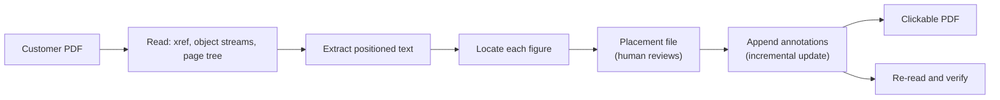

# Overlay Spec — Making an Existing PDF Clickable

**Status:** implemented and verified. Engine: `tools/evidence-pdf/src/overlay/`. CLI: `tools/evidence-pdf/src/overlay-cli.ts`.

This is the capability the positioning in [`../../IDEA.md`](../../IDEA.md) depends on:

> Keep your existing PSA, RMM, CRM, BI, CSV and PDF workflow. RipoDoc turns the client report into a secure, interactive, evidence-backed experience.

That sentence is only true if RipoDoc can take **the PDF the MSP already sends** and give it click zones. Generating a nice report of our own is a different, more crowded product — it competes with MSPBots, BrightGauge and Power BI on their terms. This engine is what keeps RipoDoc a layer rather than a replacement.

## The guarantee

> **The customer's original file is a byte-for-byte prefix of the output.**

PDF is append-only by design (ISO 32000-1 §7.5.6): new objects go at the end, a new cross-reference section indexes them, and its `/Prev` chains back to the previous one. Viewers use the newest definition of each object. RipoDoc appends a rewritten page dictionary and a link annotation per figure — and nothing else moves.

Why that guarantee and not "we re-render it faithfully":

- The MSP's client may rely on that report in a renewal conversation or a dispute. If RipoDoc re-rendered it, every font substitution, hyphenation difference and rounded coordinate would be RipoDoc's liability.
- "We did not change your document" is checkable in one command (`head -c ... | cmp -`), which makes it a fact rather than a reassurance.
- A re-render silently drops what it does not understand — tagged-PDF structure, embedded attachments, digital signatures. Appending preserves all of it.

`assertPrefixPreserved` runs on every overlay and discards the output if the prefix ever differs. A test asserts the check actually fires when a byte is flipped, because a safety check nobody has seen fail is a safety check nobody knows works.

## Pipeline



Two commands, on purpose. Step 3–4 is a heuristic; step 6 is deterministic. Keeping them apart is what stops a mis-detected zone reaching a client.

```bash
# 1. propose — detect, and write a file a person reviews
npm run overlay -- --pdf inbox/harbourview-q2.pdf \
  --manifest web/frontend/content/reports/rpt-demo-0001.json \
  --propose build/harbourview-q2.placements.json

# 2. publish — approved zones become links
npm run overlay -- --pdf inbox/harbourview-q2.pdf \
  --manifest web/frontend/content/reports/rpt-demo-0001.json \
  --placements build/harbourview-q2.placements.json \
  --out build/harbourview-q2.clickable.pdf --origin https://ripodoc.com
```

A worked example ships in the repository:

```bash
npm run overlay:propose   # against fixtures/sample-customer-report.pdf
npm run overlay:sample    # publishes it using the reviewed placements
```

## Reading a stranger's PDF

`overlay/reader.ts`. Three things break naive implementations, and all three occur in ordinary files an MSP would hand over:

| Reality | Why a simple reader fails | Handled by |
| :--- | :--- | :--- |
| **Cross-reference streams** (PDF 1.5+) | Word, Chrome and qpdf all emit them. A reader that only knows the classic `xref` table sees a modern file as empty. | `parseXrefStream`, including PNG predictors — predictor 12 is near-universal |
| **Object streams** | Page dictionaries are routinely compressed *inside* another object, so "seek to the offset and parse" finds nothing | `objectStreamIndex`, with Flate/LZW/A85/AHx/RunLength decoding |
| **Wrong offsets** | Files edited by careless tools have indexes that no longer match the bytes. Viewers rebuild by scanning rather than refusing. | `scanForObjects` fallback, per object and whole-file |

Also handled because they show up in practice: bytes before `%PDF-` (mail gateways), `/Prev` chains and hybrid `/XRefStm` files, `/MediaBox` and `/Resources` inherited from a `/Pages` node, `/CropBox` narrower than the media box, and `/Rotate`.

Refused rather than half-supported:

- **Encrypted PDFs.** Re-saving one would silently strip the protection the customer applied. `EncryptedPdfError`, always.
- **Image filters** (`DCTDecode`, `JPXDecode`, `CCITTFaxDecode`). Decoding a customer's image data has no product value and a large attack surface.

## Finding the figures

`overlay/text.ts` runs the content stream's text operators for real — text and transformation matrices, character and word spacing, horizontal scaling, rise, and the font's own advance widths — so each glyph has a rectangle, not just a character.

Two decisions worth stating:

- **Invisible text is kept.** Render mode 3 is the OCR layer of a scanned report. That layer is exactly where the numbers are findable, so a scanned QBR can still be made clickable.
- **Glyphs group into lines by writing direction and baseline**, not by `y`. Grouping by `y` breaks on rotated labels — and a rotated axis label is precisely the kind of figure someone asks to see the data behind.

Fonts (`overlay/fonts.ts`) are decoded through `/ToUnicode` when present, and through the simple-font encoding tables plus `/Differences` otherwise. A composite font with no `/ToUnicode` map is treated as **opaque**: its advances still count so later text stays positioned, but its characters are not offered for matching. Guessing a CID-to-Unicode mapping would put a link on the wrong figure, and a wrong link in a client report is worse than no link.

## Scoring — and the failure it is built around

`14` appears three times on a typical QBR page: once as the headline figure, and twice inside `148` and `143` on a chart axis. Picking wrong produces a report where a client clicks "assets at risk" and is shown April's ticket count.

A candidate is scored on evidence:

| Signal | Weight | Reason |
| :--- | :--- | :--- |
| Stands alone | +0.6 | `14` inside `148` is not a figure. Whitespace *or* a clear horizontal gap counts — adjacent table cells often produce no space character at all |
| Occupies the whole line | +0.4 | A line that is only this text is very likely the thing itself |
| Near its label | up to +1.2 | Edge-to-edge distance, not centre-to-centre: a label line spans the whole column, so its centre sits nowhere near the figure it labels |
| Set large (KPIs) | up to +0.6 | A headline figure is typeset as one |

**Locators are a fallback chain, not a pool.** If a KPI's own figure is on the page, that is the zone; the element's label is a fallback for when the figure cannot be found. Letting them compete produced the absurd outcome where a card's caption outranked the number it captioned.

When the top two candidates are within `0.25`, the element is reported as **ambiguous** and no zone is chosen. Escalating to a person is the correct output, not a failure.

## The review gate

A placement file is the reviewable artifact:

```json
{
  "reportId": "rpt-demo-0001",
  "version": 3,
  "pdfSha256": "e19fd6e8…",
  "placements": [
    {
      "elementId": "assets-at-risk",
      "page": 1,
      "rect": { "x": 218, "y": 107, "width": 37, "height": 33 },
      "matchedText": "14",
      "approvedBy": "Priya Raman",
      "approvedAt": "2026-07-02T09:10:00Z"
    }
  ]
}
```

- `rect` is in **visual space**: top-left origin, points, measured on the page as displayed. Rotation and crop box are applied when it is converted to the annotation's `/Rect`.
- `pdfSha256` binds the coordinates to one exact document. A reviewer who approved "the box around 97.4% on page 2" approved it *for that file*; re-using those coordinates against a re-export, where a paragraph reflowed and everything below moved 12 points, would put the link on the wrong number silently.
- `approvedBy` is required. `--allow-unreviewed` exists for a same-day teardown and prints a warning, but the default refuses.

This implements the determinism rule in [`interaction-spec.md`](interaction-spec.md): a machine may suggest, a person approves, publication freezes the result.

## Post-conditions

Every overlay run asserts, and refuses to write the file otherwise:

1. The original bytes are an exact prefix of the output.
2. Every element in the manifest has a zone (unless `--allow-partial`).
3. Every placement names an element that exists in this report version.
4. Every URI is `https` — `javascript:`, `file:` and `data:` are refused outright; loopback `http` only behind an explicit opt-in.
5. **The finished file, re-parsed from its trailer, contains exactly the expected links on the expected pages.** Not "we wrote N annotations" — a reader starting from scratch finds them.

## Verified against

Hand-built fixtures cover the spec (`test/helpers/pdf-fixtures.ts`): classic tables, cross-reference streams with and without predictors, object streams, rotation, crop boxes, pre-existing annotations, junk prefixes, broken indexes, and a declared `/Encrypt`.

`fixtures/sample-customer-report.pdf` covers reality: a LibreOffice export with embedded subset TrueType fonts. `overlay-sample.test.ts` runs the whole pipeline against it and pins the `14`-versus-`148` outcome, so a scoring change that regresses it fails CI.

Outputs were additionally checked with `qpdf --check` (structurally valid) and `pdftotext` (page text unchanged, byte-identical hash) across the same corpus.

## Known limitations

- **No visual authoring UI.** Placements are reviewed as JSON. A drag-a-box editor over a rendered page is the obvious next step and needs a page rasteriser.
- **No page rasterisation**, so the review step cannot show a thumbnail of the proposed zone.
- **Composite fonts without `/ToUnicode` are unmatchable.** Detection reports those elements as unmatched; a human places them by hand.
- **Vertical writing mode (`/Encoding /Identity-V`) is not handled**; advances are treated as horizontal.
- **Zones are rectangles.** A figure split across two lines gets one bounding box covering both.
- **The engine does not upload or store anything.** It is a CLI; the application-side upload, storage and review UI are not built.
