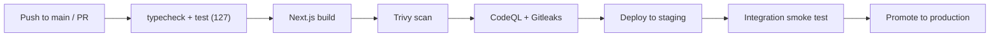

# Deployment Runbook

> The full pipeline for shipping RipoDoc from zero to production on AWS.
> **Status:** planned. Today the project ships as a static site (marketing +
> evidence pages) deployable to Vercel; the Go API, worker, RDS, and S3
> infrastructure below are the production shape after `cmd/api` lands.

---

## 1. What ships today

| Piece | How it deploys |
| :--- | :--- |
| Marketing site + evidence pages (`web/frontend`) | Vercel — `vercel deploy --prod`, environment variables set in the Vercel dashboard |
| PDF generator + overlay CLI (`tools/evidence-pdf`) | Local CLI, not deployed; CI runs the test suite |
| Audit log (`tools/audit-log`) | Verifier CLI; a database-backed sink is planned |
| Demo manifest (both copies) | Committed alongside `web/frontend/content/reports/` — served statically |

**Environment variables (web/frontend):**

| Variable | Required | Notes |
| :--- | :--- | :--- |
| `RIPODOC_EVIDENCE_SECRET` | ✅ | ≥32 chars. Signs evidence tokens. Set in the Vercel dashboard, never committed. |
| `RIPODOC_AUDIT_LOG` | optional | File path for the hash-chained append-only audit log. |

---

## 2. CI/CD (planned — GitHub Actions)



Workflow: `.github/workflows/ci.yml` — runs `npm run verify` + `docker build` security scans on every PR; deploys on merge to main. Secrets stored as GitHub Actions secrets or AWS Secrets Manager; never in repo.

---

## 3. Production architecture (planned)

```
Internet
   │
   ├── CloudFront ─── WAF ─── Web/API (ECS Fargate)
   │                              │
   │                              ├── RDS PostgreSQL (RLS on)
   │                              ├── S3 (KMS-encrypted docs)
   │                              ├── ElastiCache Redis (River queue)
   │                              └── Worker (ECS Fargate)
   │                                    │
   │                                    ├── PDF engine (TypeScript worker)
   │                                    └── AWS Textract (OCR, KMS)
   │
   └── SES (report delivery) ─── CloudTrail ─── CloudWatch
```

### Deployment steps (zero → prod)

1. **Bootstrap:** `cd infra` → `tofu init` → `tofu plan` → `tofu apply` (VPC, subnets, RDS, S3, ECS, IAM, WAF, CloudTrail, SQS/SES).
2. **Database:** run migrations (sqlc-generated/`goose`) against RDS. Enable RLS; apply tenant policies.
3. **Secrets:** store `RIPODOC_EVIDENCE_SECRET`, DB creds, KMS key ids, Stripe keys, WorkOS client secrets in AWS Secrets Manager.
4. **Build:** `docker build -t ripodoc-api .` → push to ECR.
5. **Release:** ECS service update → Fargate rolling deploy.
6. **Verify:** smoke test hitting `/healthz`, the evidence token flow, and one published report.
7. **Rollback:** ECS `deploy --rollback`; RDS point-in-time restore if migration failed.

---

## 4. Release gates

| Gate | Tool | Fails on |
| :--- | :--- | :--- |
| Typecheck | TypeScript | Any type error across web + tools |
| Tests | Node test runner | Any of 127 tests failing |
| Build | Next.js | Production build failure |
| Container scan | Trivy | Critical/high CVEs |
| Code scan | CodeQL | Security alerts |
| Secret scan | Gitleaks | Any credential in commit history |
| Dependency | Dependabot | Out-of-date/malicious packages |

---

## 5. Operations

### Backups

- RDS: automated daily snapshots, 35-day retention; monthly restore drill.
- S3: versioning + bucket policy (object-lock for audit-log anchoring when implemented).
- KMS: key rotation yearly; customer-managed keys disabled in test.

### Monitoring

| Signal | Tool | Alert on |
| :--- | :--- | :--- |
| HTTP 5xx | CloudWatch | > 1% over 5 min |
| Evidence token verification failures | CloudWatch + audit log | Sudden spike (brute force) |
| PDF generation failures | Worker logs | Any job failed |
| Postgres connections | CloudWatch | > 80% of max |
| Disk/RAM | ECS | > 85% for 10 min |

### Incident response

1. Alert fires → pager to founder.
2. Assess: is it availability or data exposure? Expose = **contain first** (revoke token key, isolate tenant), then root-cause.
3. Audit: every detected access is already logged; root-cause analysis lands in the audit channel.
4. Post-mortem: 1-page writeup in `docs/04-security/incident-response.md`.
5. Monthly restore drill + annual pen test.

---

## 6. Environment matrix

| Environment | DB | Secrets | URL | Purpose |
| :--- | :--- | :--- | :--- | :--- |
| local | Docker Postgres | `.env.local` | `http://localhost:3000` | Dev + `build:pdf:local` (loopback http opt-in) |
| staging | Shared RDS (reset) | Staging secrets | `staging.ripodoc.com` | CI verification |
| production | Production RDS | Prod secrets | `ripodoc.com` | Live product |

---

## 7. Audit log verification

The audit chain is verifiable without the server:

```bash
npm run audit:verify   # reads RIPODOC_AUDIT_LOG, asserts hash chain integrity
```

A DB-backed sink (planned) must preserve the same property: every record commits to the previous record's hash, and tampering is detectable — never "impossible," always "detectable."

---

## 8. Deployment checklist (every release)

- [ ] `npm run verify` green locally
- [ ] `npm run build:web` produces no errors
- [ ] Diff includes no environment variables
- [ ] `gitleaks detect` clean
- [ ] Changelog updated (when process exists)
- [ ] Migration reviewed (new schema)
- [ ] Audit log event recorded for the release (planned)